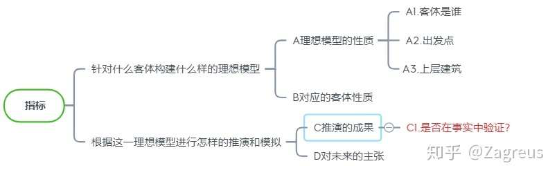
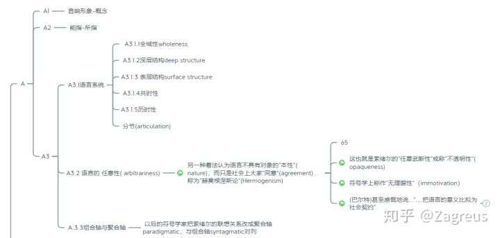

# 2.1经典符号学理论-索绪尔的系统论

> 来源：知乎专栏 https://zhuanlan.zhihu.com/p/237248332

本章讨论**经典符号学理论**均按以下指标进行梳理

研究客体及其建立的模型
模型的性质及其对应的客体性质
此模型在现实中进行推演分析的成果

## 索绪尔

**其符号学为其语言学所服务**

## 2.1.1能指与所指

## 2.1.2语言的任意性(arbitrariness)

## 2.1.3语言系统及其性质

> 全域性
> 深层结构与表层结构
> 共时性与历时性
> 分节articulation

## 2.1.4组合轴syntagmatic与聚合轴paradigmatic

## 2.1.5分析应用

> 双轴关系与雅各布森的失语症研究

### 2.1.1能指与所指

> [概念和音响形象]这两方面紧密结合并且相互依存。无论我们是想知道拉丁语中arbor这个的意思，还是在拉丁语中"树"是用哪个词表达的，很显然，只有这个语言的结合体被运用于我们的现实生活中时才会被认可。
> **我们把概念和音响形象的结合体称为"符号"**
> 我们保留"符号"这个词来指称这个整体，把"概念"和"音响形象"分别用所指和能指来替代

可见索绪尔所说的"概念"是思维活动时调用的对象。而他将音响形象解释为"**一种心理印迹**"

> [音响形象]...不是一个实质性的声音，不是一个纯粹物理的东西，而是声音在我们的意识里形成的一种心理印迹。

的确，就物理的角度而言，**同一个人对同一个词句的两次发音是完全不等价的**。至于像似的程度则取决于测量的精度和误差。这种差异会使"语言"的内容多到无法分析。因此必须对其进行处理，将它们视作**同一**的。[由于在现实中我们的思维也是这样处理语言信息的，这一做法不仅仅是语言学家处理研究对象的手段，也是**一种认知本能**。我认为索绪尔的"心里印记"的说法是**存在对应的神经学领域的物质基础的**。]

因此，音响形象对应**能指**，概念对应**所指**。能指与所指，就是索绪尔的理论的出发点。

### 2.1.2语言系统及其性质

#### 语言的任意性

对于语言与其指代的对象的关系，西方哲学已有"长达两千五百年的辩论"。

> 一种认为词语与对象天然有关系，此论点被称为"克拉提鲁斯论"(Cratylism)
> 另一种看法认为语言不具有对象的"本性"(nature)，而只是社会上大家"同意"(agreement)...称为"赫莫根涅斯论"(Hermogenism)。这也就是索绪尔的"任意武断性"或称"不透明性"(opaqueness)。符号学上称作"无理据性"(immotivation)

**无所谓对错，只有选择与后果。**

索绪尔的理论聚焦于发音与概念，讨论的是语言中**抽象概念**以及与**具象的发音、书写**部分的问题。可以说，他探寻的是**和语音相关联的语言**。因此，他讨论的内容**不包含象形文字和方程式**。

在他的理论的起点，语言本身被看作是**绝对抽象**的。而他的目的就在与向读者展示自己的理论如何通过语音将**抽象的语言拖入具象的**分析中。

> 因此，他称符号学是"形式，而不是实质的的科学"

因此，为了保证这一"绝对抽象"，**他需要将语言与图像等具象的事物泾渭分明地划分开来**。为此，他选择了任意性arbitrariness——能指对应什么所指，仅仅是一种纯粹经验的规约。大家都认同这种关系，于是它们之间便是这种关系

当然，索绪尔还讨论**显然不遵循任意性的**拟声字，在此略过。

### 2.1.3语言系统及其性质

足够多的相关的能指-所指相连接，就构成了一个语言系统。

在索绪尔的模型里语言系统具有如下的性质

**全域性**

每一种语言的内容都足够为使用者提供任何需要的表达。**每一种语言都覆盖全域**，因此不同语言的表达会有**足够多的交集**，使得翻译成为可能。

**深层结构与表层结构**

每一种语言都有无限多种可能、可取的表达。这些表达的集合就是该语言系统的**深层结构**。某个言语者在使用某种语言进行表达时，他选择表达只是恒河沙数般的选项中的的一项。这一项是深层结构的真子集，也就是这一语言系统的**某一表层结构**

**共时性与历时性**

只有足够多的人在同样的时空中使用同样的表达时，这些表达才能被纳入一门语言之中。音响形象-概念的**数量和同时空出现**，是它们能够组成一个语言系统的必要条件

"同时空出现"这一性质即共时性，**具有共时性的符号才能组成一个系统。**

然而语言系统是变动不居的，**系统在历时性中变化。**

**分节articulation**

语言系统自然不是一个混沌的整体。其内部可以进行进一步的划分。划分的结果就是**分节**articulation。

> "应该用到语言上，分节既表明为说出来的语词链分为音节，也表明意义链分节为有意义的单元。

### 2.1.4组合轴syntagmatic与聚合轴paradigmatic

> 以后的符号学家把索绪尔的联想关系改成聚合轴paradigmatic，与组合轴syntagmatic对列

所有的文本都有其表层含义和深层含义。表层含义可以仅仅从字句的搭配中解读出来。深层含义则依赖于"意会"。创作文本的目的可以很丰富，但最终的作品却只能是遵循语法与句式的字句。

字词的所有可能组合称为**组合轴**。表达的全部对象称为**聚合轴**。

### 2.1.5分析应用

> 1956年，雅各布森发表了一篇著名论文《语言地两个方面，与失语症地两种类型》
> 他指出组合各组分之间的关系是邻接continguity，而聚合各组分的关系是像似similarity。依靠相似性形成关系的正是组成比喻metaphor的方式。
> 医学上失语症基本可以分成两大类
> 一类病人看来失去了组合功能，语句没有正常的句法组合，词序混乱……但他们保持了聚合的能力……例如会使用"小望远镜"来代替"显微镜"
> 另一类病人似乎失去了聚合能力，原来能说多种方言或多国语言的人依然有说这些方言或原因呢的呢国库，但是难以转换、难以翻译……他们的用词机器贫乏，无法使用隐喻，但……句子语法很正确，各种连接要素很完整
